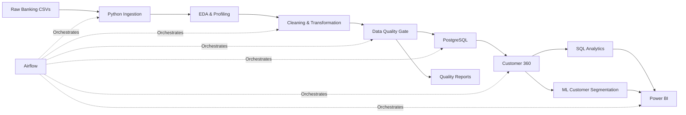

# Banking Data Engineering & Customer Intelligence Platform

> **An end-to-end banking data platform built with Python, SQL, PostgreSQL, Airflow, Scikit-learn and Power BI.**

This project simulates a realistic banking data environment and demonstrates how raw customer, account, product and transaction data can be transformed into **reliable analytical datasets and customer intelligence insights**.

The project is intentionally designed as a **data-engineering-first system**: data ingestion, transformation, quality validation and database modeling form the foundation, while Customer 360 analytics, machine-learning segmentation and Power BI provide the analytical layer.

---

## Project Overview

### Business problem

A banking organization works with multiple operational datasets such as:

- customers
- accounts
- transactions
- products
- customer-product relationships

These datasets are useful individually, but business and analytics teams need a consistent, validated and centralized view of the data.

This project builds a pipeline that answers questions such as:

- How do we ingest and standardize banking data?
- How do we detect data-quality problems before analytics?
- How do we model customer/account/transaction relationships?
- How can we create a Customer 360 view?
- How can customer behavior be segmented using machine learning?
- How can the resulting data be presented to business users?
- How can the pipeline be automated and tested?

---

## End-to-End Architecture



### Simplified flow

```text
Raw Data
   ↓
Ingestion
   ↓
EDA / Profiling
   ↓
Cleaning & Transformation
   ↓
Data Quality Gate
   ↓
PostgreSQL
   ↓
Customer 360 + SQL Analytics
   ↓
K-Means Customer Segmentation
   ↓
Power BI
```

**Airflow** is used as the orchestration layer around the pipeline.

---

# Key Features

## 1. Python-based Data Ingestion

The pipeline reads the raw banking CSV files and prepares them for downstream processing.

```text
customers.csv
accounts.csv
transactions.csv
products.csv
customer_products.csv
```

The ingestion layer is designed to keep raw inputs separate from processed outputs.

---

## 2. Exploratory Data Analysis

The EDA stage profiles every raw dataset before transformation.

It checks:

- row count and column count
- file size and memory usage
- data types
- sample records
- missing values
- exact duplicate rows
- duplicate business keys
- categorical value counts
- numerical distributions
- outlier/tail behavior
- date ranges and time trends
- cross-table relationships
- transaction/account chronology

Notebook:

```text
notebooks/eda.ipynb
```

The EDA process intentionally treats large values carefully: an extreme transaction or balance is not automatically considered invalid because legitimate banking data can contain long-tail observations.

---

# Dataset


| Dataset | Records |
|---|---:|
| Customers | 5,000 |
| Accounts | 7,688 |
| Transactions | 200,000 |
| Products | 12 |
| Customer-Product Relationships | 16,289 |

### Raw data model

```text
customers
    │
    ├────────────── accounts
    │                    │
    │                    └──────────── transactions
    │
    └────────────── customer_products
                         │
                         └──────────── products
```

### Raw files

```text
data/raw/
├── customers.csv
├── accounts.csv
├── transactions.csv
├── products.csv
└── customer_products.csv
```

More information:

```text
data/data_dictionary.json
docs/DATA_MODEL.md
```

---

# Data Engineering Pipeline

## Extract

Python reads the source CSV files into structured DataFrames.

```text
Raw CSV
  ↓
Pandas
  ↓
In-memory DataFrame
```

## Transform

The transformation layer:

- standardizes column names
- normalizes data types
- parses dates
- cleans textual values
- handles invalid domain values
- creates derived analytical fields

## Validate

Before publication, the data passes a quality gate.

Validation includes:

- primary-key uniqueness
- required-field completeness
- foreign-key integrity
- positive transaction amounts
- non-negative account balances
- customer age rules
- transaction/account/customer consistency
- transaction chronology

A failed quality gate prevents unreliable analytical output from being published.

## Load

Validated data is loaded into PostgreSQL.

The database contains the core relational banking tables and analytical views used by SQL and BI layers.

---

# Customer 360

The Customer 360 layer combines information from multiple banking entities into a customer-level analytical view.

Example fields:

```text
customer_id
age
city
occupation
annual_income

account_count
total_balance
average_balance

transaction_count
total_transaction_value
average_transaction_value
last_transaction_date

product_count
```

This creates a common analytical base for customer behavior analysis.

Output:

```text
data/analytics/customer_360.csv
```

---

# Machine Learning — Customer Segmentation

The project includes an **unsupervised machine-learning layer** using **K-Means clustering**.

### Why segmentation?

Customer 360 features can be used to discover groups of customers with similar financial/activity patterns without assigning predefined labels.

### Features

The segmentation uses customer-level behavioral and financial features such as:

- annual income
- total balance
- successful transaction count
- total transaction value
- average transaction value
- product count
- customer tenure

Because monetary and count variables can be strongly skewed, the modeling pipeline applies transformation/scaling before clustering.

Candidate cluster counts are evaluated using **silhouette score** and a selected configuration is then used to generate segment assignments and segment profiles.

### Outputs

```text
data/analytics/customer_segments.csv
data/analytics/segment_profiles.csv
data/analytics/segmentation_model_selection.csv
```

### Important interpretation note

Cluster labels are model outputs. Names such as "high activity" or "investment-oriented" should be assigned only after inspecting the numerical profile of each cluster; the model itself does not know business labels.

---

# SQL Analytics

The SQL layer demonstrates relational analysis on the banking data.

Examples include:

- customer transaction activity
- transaction value by channel
- product adoption
- customer account relationships
- high-value customer analysis
- monthly transaction trends
- customer-level aggregations
- segment-level summaries

SQL files:

```text
sql/schema.sql
sql/views.sql
sql/analytics_queries.sql
```

---

# Power BI Dashboard

The dashboard is designed as three pages, each with a different purpose.

## Page 1 — Executive Overview

Answers:

> **What is happening across the overall banking portfolio?**

Key elements:

- Total Customers
- Total Accounts
- Total Balance
- Total Transactions
- Total Transaction Value
- Average Transaction Value
- Monthly Transaction Value Trend
- Transaction Volume by Channel
- Product Adoption
- Customers by City

---

## Page 2 — Customer Intelligence

Answers:

> **Who are the customers and how do their behaviors differ?**

Key elements:

- customer distribution by segment
- transaction value by segment
- balance vs transaction value
- average products by segment
- customer distribution by occupation
- Customer 360 detail table
- slicers for segment, city, occupation and gender

---

## Page 3 — Data Engineering Monitor

Answers:

> **Is the data reliable and ready for analytics?**

Key elements:

- data quality score
- records checked
- missing records
- duplicate records
- invalid records
- quality score by dataset
- quality issues by dataset
- monthly transaction volume
- transaction volume by channel
- dataset quality status
- data-quality audit log

Power BI-ready tables are stored under:

```text
data/powerbi/
```

Dashboard instructions:

```text
dashboard/POWER_BI_BUILD_GUIDE.md
```

---

# Data Quality Monitoring

The project treats data quality as a first-class engineering concern.

### Example checks

```text
✓ Primary key uniqueness
✓ Required fields
✓ Foreign key integrity
✓ Positive transaction amounts
✓ Non-negative balances
✓ Valid customer ages
✓ Customer/account consistency
✓ Transaction chronology
```

Quality outputs:

```text
data/quality_reports/
```

EDA reports:

```text
data/eda_reports/
```

---

# Airflow Orchestration

The working pipeline can be orchestrated using Apache Airflow.

Example task flow:

```text
extract
   ↓
transform
   ↓
validate
   ↓
load_postgres
   ↓
customer_360_and_ml
   ↓
publish_powerbi
```

DAG:

```text
dags/banking_pipeline.py
```

The project is intentionally structured so that the underlying Python pipeline can be developed and tested independently before introducing Airflow orchestration.

---

# Testing

Automated tests are implemented with **Pytest**.

Examples:

- data-quality validation
- transformation correctness
- analytical output checks

Run:

```bash
pytest -q
```

---

# Project Structure

```text
Banking_Data_Engineering_Customer_Intelligence/
│
├── data/
│   ├── raw/
│   ├── processed/
│   ├── quality_reports/
│   ├── analytics/
│   ├── powerbi/
│   └── data_dictionary.json
│
├── src/
│   ├── ingestion/
│   ├── transformation/
│   ├── validation/
│   ├── loading/
│   ├── analytics/
│   └── ml/
│
├── sql/
│   ├── schema.sql
│   ├── views.sql
│   └── analytics_queries.sql
│
├── notebooks/
│   └── eda.ipynb
│
├── dags/
│   └── banking_pipeline.py
│
├── tests/
│
├── dashboard/
│   ├── POWER_BI_BUILD_GUIDE.md
│   └── theme.json
│
├── docs/
│   ├── PROJECT_ARCHITECTURE.md
│   ├── DATA_MODEL.md
│   ├── EDA_RESULTS.md
│   ├── AIRFLOW_SETUP.md
│   ├── INTERVIEW_STORY.md
│   └── ASSUMPTIONS_AND_LIMITATIONS.md
│
├── scripts/
│   └── run_pipeline.py
│
├── docker-compose.yml
├── requirements.txt
├── .env.example
├── .gitignore
└── README.md
```

---

# Tech Stack

| Layer | Technology |
|---|---|
| Programming | Python |
| Data Processing | Pandas, NumPy |
| Database | PostgreSQL |
| Querying | SQL |
| Machine Learning | Scikit-learn |
| Orchestration | Apache Airflow |
| Visualization | Power BI |
| Testing | Pytest |
| Containerization | Docker |
| Version Control | Git / GitHub |

---

